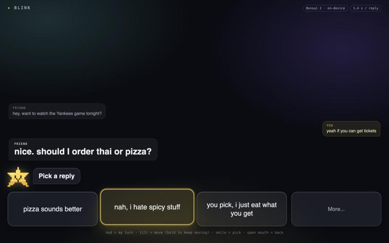
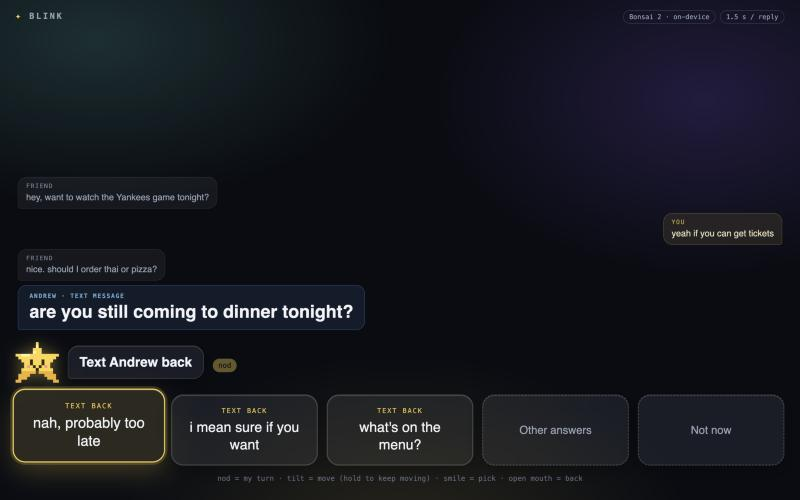
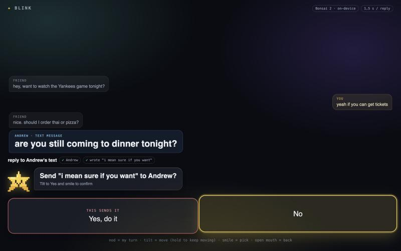
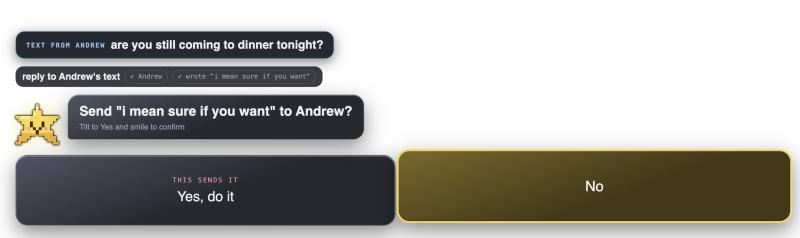
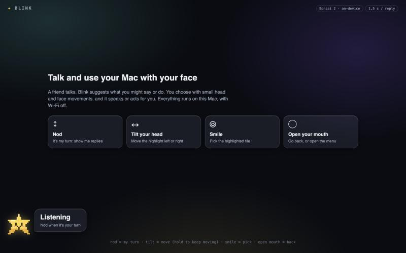
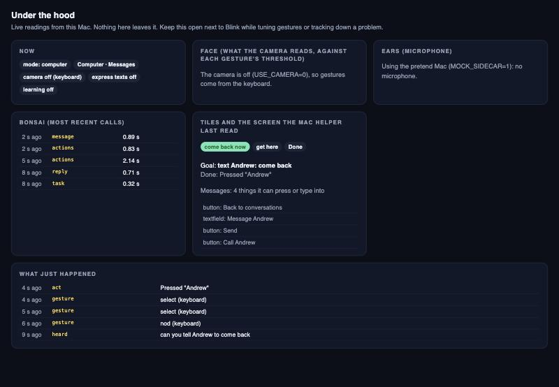

# OpenMouth

Talk, text, and use your Mac with a nod, a head tilt, and a smile. Fully on-device: it works with Wi-Fi off.

Built for the Local AI Hackathon (Recreate theme). Bonsai 2 predicts what you want to say or do, Argmax (WhisperKit + TTSKit) hears and speaks, and the macOS Accessibility API clicks and types.



## What it does

Theo can't speak clearly or use his hands. With OpenMouth:

- **A friend talks, Theo answers.** OpenMouth transcribes the friend, Bonsai suggests three replies, Theo tilts his head to choose and smiles to pick, and the Mac says it in his voice. The replies are ready before he nods.
- **A friend asks him to do something, and he does it.** "Can you tell Andrew to come back?" becomes: agree out loud, open Andrew's chat, pick a wording, confirm, sent. About 9 seconds and five picks (three with `EXPRESS=1`).
- **A text arrives, and he answers it.** "Andrew texted you. Nod to answer." One pick opens Messages, opens the chat and types the answer; a second confirms it.
- **He searches the web.** In Safari tasks there is a "Search: ..." tile made from what was asked ("look up the Yankees score"); the results come back as tiles to open. This is the one thing that needs a network.
- **He starts things himself.** Open mouth for the menu: quick phrases that need no model ("I need help"), text someone, use the computer step by step, repeat the last thing said, or stop listening.
- **It learns his voice.** The replies he actually picks are kept on the Mac and shown to Bonsai as examples, so suggestions drift toward how he really talks.

Nothing leaves the machine. There is no account, no cloud call, and no telemetry.

| | |
|---|---|
|  |  |
|  |  |

## What we recreated

- **Synchron's BCI chat (powered by OpenAI):** a brain implant where AI predicts replies and the user picks one with a single "click." We replace the implant with webcam face gestures and the cloud with Bonsai 2 on the laptop.
- **AAC apps like Lingraphica Conversations and Predictable:** listen to the conversation partner and suggest replies. Ours never sends a word off the device.
- **Google Project Gameface:** face gestures as a mouse. We add an AI that predicts what you want, so one gesture does a whole step.

## Gestures

| Gesture | Meaning |
|---|---|
| Nod | My turn: show replies (or answer the text that just came in) |
| Tilt head left / right | Move the highlight. Hold to keep moving |
| Smile | Pick the highlighted tile |
| Open mouth | Back. From listening: open the menu |

On the demo Mac the camera triggers for "my turn" and "back" are swapped, because that camera picks up the mouth more reliably than a nod. The screen and the wording stay the same. `NOD_SWAP=0 ./start.sh` or the **Swap turn/back** checkbox in the dev bar turns the swap off.

Keyboard and mouse work too, for rehearsal or a helper: `N` nod, `←` `→` move, `Space` pick, `Esc` back, `1`-`5` or a click to pick a tile directly, `C` relearn the neutral face, `D` hide the dev bar.

## Run it on the Mac

One time: clone PrismML's [Bonsai-demo](https://github.com/PrismML-Eng/Bonsai-demo) next to your home folder and run `BONSAI_MODEL=9B ./setup.sh`; create the Python env (`python3 -m venv .venv && .venv/bin/pip install -r hub/requirements.txt`); and give your terminal **Microphone**, **Camera** and **Accessibility** permission in System Settings > Privacy & Security.

```bash
./start.sh                      # Bonsai (:8080) + sidecar (:8790) + hub (:8000)
./doctor.sh                     # checks models, permissions, mic, camera, sound devices
./stop.sh                       # stop everything (--keep-bonsai leaves the model loaded)
```

Then open http://127.0.0.1:8000, or float the tiles over your other apps:

```bash
NOD_OVERLAY=1 ./start.sh        # transparent, click-through, always on top
```

Useful switches (all optional, set before `./start.sh`):

| Variable | Meaning |
|---|---|
| `USE_CAMERA=0` | Keyboard only, no webcam |
| `CAMERA_INDEX=1` | Use the second camera (an iPhone can grab the first slot) |
| `NOD_OVERLAY=1` | Floating tile window instead of a browser tab |
| `NOD_WATCH_MESSAGES=1` | Tell OpenMouth when a text message arrives |
| `NOD_SILENT=1` | Rehearsal: speech is generated but not played |
| `NOD_TTS_SPEAKER`, `NOD_TTS_STYLE` | Voice and how it speaks (see `sidecar/README.md`) |
| `LEARN=0` | Don't remember picked replies |
| `EXPRESS=1` | Texting someone in the profile takes 3 picks instead of 5: agree, pick a wording, confirm |
| `NOD_SWAP=0` | Don't swap the camera triggers for "my turn" and "back" |
| `DEMO_GUIDE=1` | Script the three options for the rehearsed demo lines in `prompts/demo.json`. Off by default: every reply comes from Bonsai |
| `NOD_GESTURES=classic` | The older gesture rules, if the new ones don't suit your face. The dev bar's **Classic gestures** checkbox switches while running |

First run needs Wi-Fi once to download the speech and face models. After that everything loads from disk.

http://127.0.0.1:8000/debug shows live what the camera and microphone read against their thresholds, Bonsai's timings, and a log of what just happened.



Tune the gestures for whoever is demoing, on the camera they will use: `python -m hub.face --measure` (70 seconds, guided) prints values for the top of `hub/face.py`.

## Rehearse without a Mac, a camera or a microphone

The hub runs anywhere with a pretend Mac (`hub/sidecar.py`, Messages and Safari that react to what you do):

```bash
USE_CAMERA=0 MOCK_SIDECAR=1 .venv/bin/uvicorn hub.main:app --port 8000
```

Type what the friend says in the dev box. Type `/text Andrew: where are you` to pretend a text arrived. If Bonsai isn't running, the hub still works with basic replies and says "Bonsai is offline".

## How it works

```
 friend's voice ─► SIDECAR (Swift) ─ POST /heard ─► HUB (Python) ─► Bonsai 2 (llama-server)
                   WhisperKit: mic → text            state machine     replies, next step,
                   TTSKit: text → voice   ◄─ /speak ─  prompts          message wording
                   Accessibility: read    ◄─ /screen ─ gestures ◄─ webcam (MediaPipe)
                   the screen, click, type ◄─ /act ───  │
                   overlay window                        └─► tiles (browser tab or overlay)
```

| Piece | Folder | Notes |
|---|---|---|
| Hub: state machine, Bonsai calls, websocket to the tiles | `hub/` | Python, FastAPI |
| Gesture rules | `hub/gestures.py`, thresholds in `hub/face.py` | drift-following neutral pose, tested with traces |
| Tiles | `ui/index.html` | one file, no build step, no external assets |
| Prompts | `prompts/*.txt` | fixed part above `=====` is cached, changing part below |
| Character | `hub/profile.json` | who he is, how he talks, people, apps, quick phrases |
| Sidecar: ears, voice, hands, overlay | `sidecar/` | Swift, Apple Silicon only |
| Interfaces | `SPEC.md` | the contract between all of the above |

What makes it feel fast on a laptop:

- Replies are written during the friend's pause, so a nod shows them at once.
- Every prompt's fixed part (who he is, the rules) is cached by llama-server; only the conversation and screen are read each time.
- For computer steps Bonsai answers with short codes ("press 3"), not paragraphs. A step takes 1.5 to 2.5 s.
- The first computer step is worked out while "yeah one sec" is still being spoken.
- Speech starts about half a second after a pick, and captions use a small Whisper model while a large one writes the final sentence.

What keeps it safe:

- Anything that sends is confirmed first, with the text and the recipient spoken and shown, and "No" highlighted.
- The person the friend named is always the recipient, whatever Bonsai guessed.
- The Mac never hears itself: the microphone is ignored while it speaks and for 400 ms after.
- If the camera loses his face, Bonsai is down, or the helper stops answering, the screen says so plainly and nothing freezes.

## Tests

```bash
./test.sh        # 84 checks in a few seconds: no model, camera, microphone or network needed
./test.sh --all  # also runs the real sidecar on a recording, silently (about a minute)
python tests/run_all.py   # the same fast checks on any OS (Windows too)
```

They cover the gesture rules on made-up head traces, the camera thread with fake frames, the whole hub loop against the pretend Mac with a stand-in model (talk, texting, answering a text, confirmations, failures), the fixed rules around Bonsai's answers, and 3,000 random actions with failures injected, after each of which nothing may be stuck and nothing may have been sent without a Yes (`python tests/test_random_actions.py 20000 3` for a longer run).

## Working on it

- `SPEC.md` is the source of truth for every interface. Change it first, then the code.
- Kyle owns `hub/`, `ui/`, `prompts/`. The partner owns `sidecar/`.
- Tune prompts in `prompts/*.txt` and the character in `hub/profile.json` without touching code.
- `OVERNIGHT.md` lists what changed on the `overnight` branch and what has not been tried on a real Mac yet.
